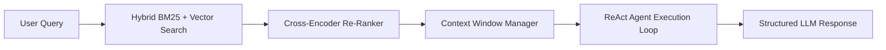

# AI RAG Orchestrator & Autonomous Agent Pipeline 🤖🧠

A modular, production-ready framework for building Retrieval-Augmented Generation (RAG) applications, hybrid BM25 + dense vector search, and tool-calling ReAct agents.

## 🚀 Architecture Highlights
1. **Dense Vector Search**: Pure-Python Cosine and Dot-Product similarity search with embedding cache.
2. **Hybrid BM25 Retrieval**: Combines sparse keyword scoring with dense embeddings for high-precision retrieval.
3. **ReAct Autonomous Agent**: Reasoning and acting cycle (`Thought -> Action -> Observation -> Final Answer`).
4. **Token Budget & Context Window Management**: Sliding window buffer preventing context overflow.

## 📋 System Architecture

